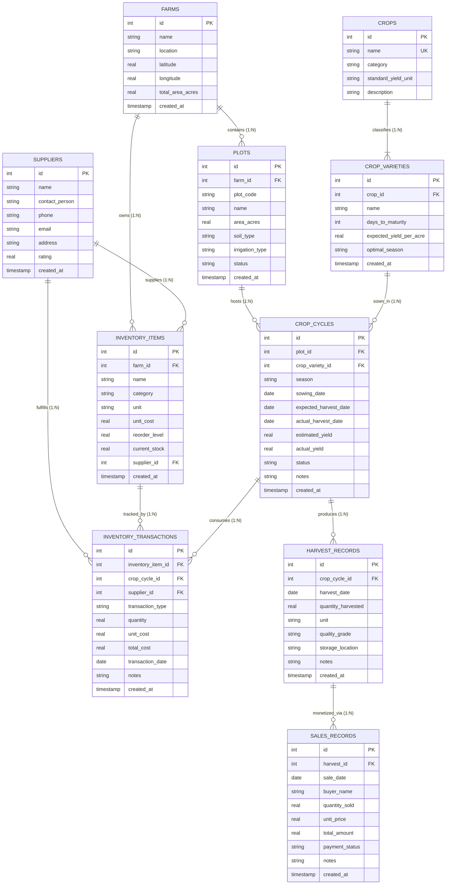

# FarmLedger: Farmer Crop Planning & Agricultural Inventory System
## Database Management Systems (DBMS) Laboratory Project Report

---

# 1. Title Page

<div align="center">

# **FARMLEDGER**
### **A Farmer Crop Planning & Agricultural Inventory Management System**

\
**A Capstone Laboratory Project Report Submitted in Partial Fulfillment of the Requirements for the Degree of**  
**Bachelor of Technology / Bachelor of Engineering**  
**in**  
**Computer Science and Engineering / Information Technology**

\
\
**Course:** Database Management Systems (DBMS) Laboratory  
**Academic Year:** 2025 – 2026  

\
\
**Submitted by:**  
**Project Group No.:** `[Group Number, e.g., Group 14]`

| S. No. | Student Full Name | University Roll Number | Registration / PRN Number |
| :---: | :--- | :---: | :---: |
| 1. | Prakitesh B. | `[Roll Number 1]` | `[Registration No. 1]` |
| 2. | `[Team Member 2 Name]` | `[Roll Number 2]` | `[Registration No. 2]` |
| 3. | `[Team Member 3 Name]` | `[Roll Number 3]` | `[Registration No. 3]` |
| 4. | `[Team Member 4 Name]` | `[Roll Number 4]` | `[Registration No. 4]` |

\
\
**Under the Guidance of:**  
**`[Faculty / Guide Name]`**  
Assistant Professor / Associate Professor  
Department of Computer Science & Engineering  

\
\
**DEPARTMENT OF COMPUTER SCIENCE AND ENGINEERING**  
**`[COLLEGE / INSTITUTION NAME]`**  
`[Affiliated University / Autonomous Body]`  
`[Campus City, State, PIN Code]`  

**November 2026**

</div>

<div style="page-break-after: always;"></div>

---

# 2. Introduction

Agriculture forms the socioeconomic backbone of developing economies, employing over 40% of the active workforce and accounting for significant domestic output. Despite modern advancements in hybrid cultivars, drip fertigation, and mechanization, small-to-medium scale farmers manage day-to-day operations using disjointed, manual record-keeping methods. Vital agronomic parameters—such as seed variety emergence windows, nitrogen-phosphorus-potash (NPK) top-dressing timelines, pesticide batch expiry, harvest batch yields, and merchant gate sale realizations—are typically kept in paper notebooks or memory.

**FarmLedger** is a full-stack, database-centric web application engineered to solve the operational and financial challenges of farm management. The platform integrates:
- Multi-plot spatial management (recording area, soil composition, and irrigation infrastructure).
- Crop variety life-cycle scheduling (tracking sowing milestones, expected maturation intervals, and harvest yields).
- An audit-grade, double-entry inventory ledger (monitoring inputs such as seeds, fertilizers, and agrochemicals).
- Harvest monetization and sales accounting (tracking sold versus unsold produce).
- Live meteorological correlation using external REST APIs (Open-Meteo).

Unlike typical surface-level web applications that hide database operations behind opaque Object-Relational Mappers (ORMs), FarmLedger is constructed with the **relational database engine as its primary architectural component**. Data integrity, state transitions, financial balance preservation, and inventory underflow prevention are strictly enforced at the database layer using raw SQL DDL, domain `CHECK` constraints, foreign key referential actions, SQL triggers, and analytical views.

---

# 3. Problem Statement

Small and medium-scale farm enterprises suffer from operational fragmentation due to the absence of a unified, integrity-enforced data management system. Specifically, the agricultural domain is plagued by four core issues:

1. **Inventory Stockouts and Input Wastage:**
   Agricultural inputs (such as certified hybrid seeds, soluble fertilizers, and systemic insecticides) represent substantial working capital. Without strict ledger accounting, farmers experience stockouts during critical 48-hour planting windows or incur financial losses due to agrochemical expiration, leakage, and untracked wastage.
2. **Yield Variance Blindness:**
   Crop productivity varies significantly across plots due to variations in soil chemistry, irrigation regimes, and micro-climates. Farmers rarely measure the mathematical variance between the **agronomical estimated yield** and the **actual harvested yield**. Consequently, chronic yield deficits caused by soil depletion, improper spacing, or pest infestations go unnoticed.
3. **Inability to Isolate True Cost-per-Acre:**
   Input expenditures are usually logged as aggregate household expenses rather than being mapped to specific land plots or crop cycles. Farmers cannot answer fundamental economic questions: *Did Plot North-01 with Drip irrigation yield a higher Return on Investment (ROI) than Plot East-02 under sprinkler irrigation?*
4. **Disconnection from Real-Time Meteorological Risks:**
   Sowing and harvesting operations are sensitive to extreme weather events. Excessive precipitation ($\ge 15\text{ mm/day}$) immediately after sowing leads to waterlogging, poor seed respiration, and seed rot. High heat ($\ge 35^\circ\text{C}$) during transplanting causes seedling mortality. Farmers lack systems that synchronize planned agricultural database milestones with forecasted weather patterns.

---

# 4. Objectives

The primary engineering and database objectives of FarmLedger are:

1. **Design a 3NF Normalized Relational Schema:**
   Formulate a clean, anomaly-free relational schema modeling farms, plots, crops, cultivars, suppliers, inventory items, append-only transactions, harvest batches, and merchant sales.
2. **Enforce Database-Tier Integrity via SQL Constraints & Triggers:**
   - Implement `BEFORE INSERT` triggers to reject inventory usages that would result in negative stock balances (`current_stock < 0`).
   - Implement `AFTER INSERT` triggers on ledger transactions to automatically synchronize current on-hand quantities and update unit purchase costs.
   - Enforce sales integrity triggers to prevent merchant sales from exceeding actual harvested produce.
   - Implement automatic yield rollup triggers updating parent crop cycle records upon harvest entry.
3. **Develop Analytical Views and Complex SQL Queries:**
   - Construct reusable database views (`v_current_stock_levels`, `v_low_stock_items`, `v_out_of_stock_items`, `v_monthly_inventory_value`, `v_estimated_vs_actual_yield`).
   - Write advanced analytical queries employing Common Table Expressions (CTEs), multi-table joins, mathematical variance projections, and SQL window functions (`LAG() OVER`).
4. **Build a Responsive, Minimal User Interface:**
   Construct an intuitive white dashboard layout with tabbed operational workflows (Financial, Operations, Inventory), interactive Recharts visualizations, and RFC-4180 compliant CSV reporting.
5. **Integrate Real-Time Meteorological Intelligence:**
   Incorporate the Open-Meteo REST API to retrieve 7-day micro-climate forecasts based on relational farm coordinates, cross-referencing weather hazards against scheduled sowing and harvest dates.

---

# 5. Technology Used

| Component / Layer | Technology Selected | Version | Purpose in Architecture |
| :--- | :--- | :--- | :--- |
| **Database Engine** | **SQLite 3 / Native C-Core** | 3.45+ | ACID-compliant relational storage engine utilizing foreign key enforcement, B-tree indexes, views, and SQL triggers. |
| **Backend Runtime** | **Node.js** | v24.13.0 | Asynchronous event-driven JavaScript server runtime. |
| **Server Framework** | **Express.js** | v4.21.2 | REST API microframework routing requests and handling raw SQL parameter bindings without an ORM. |
| **Frontend Framework** | **React.js** | v19.3.1 | Declarative component-based user interface. |
| **Build Tool** | **Vite** | v8.3.6 | Frontend bundler with Hot Module Replacement (HMR). |
| **Styling & Design** | **Tailwind CSS** | v4.3.5 | Utility-first responsive CSS framework providing a minimal, clean dashboard aesthetic. |
| **Data Visualization** | **Recharts** | v3.10.1 | Composable SVG charting library for category donut charts, dual-axis composed 12-month value trends, and multi-season yield comparisons. |
| **Icons & Symbols** | **Lucide React** | v1.70.0 | Clean iconography for operational clarity. |
| **External API** | **Open-Meteo API** | Free / v1 | Open-access global meteorological forecast API providing daily temperature, precipitation, and wind speeds without API key requirements. |
| **Version Control** | **Git & GitHub** | 2.44+ | Distributed version management repository tracking complete SQL DDL, DML, and application source code. |

---

# 6. Entity-Relationship (ER) Diagram

The system's entities, key structural attributes, cardinalities, and relational constraints are modeled in the diagram below:



### Cardinality Explanations:
- **`FARMS` to `PLOTS` (1:N):** One farm encompasses one or more delineated land plots; each plot belongs exclusively to one farm (`ON DELETE CASCADE`).
- **`CROPS` to `CROP_VARIETIES` (1:N):** A general botanical crop (e.g., *Wheat*) categorizes multiple commercial varieties (*HD-2967 Golden*, *Sharbati*).
- **`PLOTS` & `CROP_VARIETIES` to `CROP_CYCLES` (M:N via associative entity):** A plot can host various crop cycles over seasons, and a variety is sown across multiple plots over time. The `CROP_CYCLES` relation acts as the associative entity capturing temporal bounds, estimated yield, and actual yield.
- **`INVENTORY_ITEMS` to `INVENTORY_TRANSACTIONS` (1:N):** An inventory item is tracked through an immutable append-only transaction ledger (`purchase`, `usage`, `wastage`, `adjustment`).
- **`HARVEST_RECORDS` to `SALES_RECORDS` (1:N):** A single harvest batch may be sold across multiple market transactions (e.g., partial sales to distinct wholesalers or retail buyers).

---

# 7. Database Design & Normalization

The data dictionary below outlines the relational table designs, explicit domains, and constraint declarations.

### 7.1 Data Dictionary

#### 1. `farms` Table
| Column Name | Data Type | Constraints | Description |
| :--- | :--- | :--- | :--- |
| `id` | `INTEGER` | `PRIMARY KEY AUTOINCREMENT` | Unique identifier for the farm entity |
| `name` | `TEXT` | `NOT NULL` | Commercial or official name of the farm |
| `location` | `TEXT` | `NOT NULL` | Geographical district or regional valley |
| `latitude` | `REAL` | `NOT NULL` | Decimal latitude coordinate (used for Open-Meteo) |
| `longitude` | `REAL` | `NOT NULL` | Decimal longitude coordinate (used for Open-Meteo) |
| `total_area_acres` | `REAL` | `NOT NULL, CHECK (total_area_acres > 0)` | Total physical acreage of the estate |
| `created_at` | `TEXT` | `NOT NULL DEFAULT CURRENT_TIMESTAMP` | System registration timestamp |

#### 2. `plots` Table
| Column Name | Data Type | Constraints | Description |
| :--- | :--- | :--- | :--- |
| `id` | `INTEGER` | `PRIMARY KEY AUTOINCREMENT` | Unique plot identifier |
| `farm_id` | `INTEGER` | `NOT NULL, REFERENCES farms(id) ON DELETE CASCADE` | Foreign Key to parent farm |
| `plot_code` | `TEXT` | `NOT NULL` | Alphanumeric survey code (e.g., `P-NORTH-01`) |
| `name` | `TEXT` | `NOT NULL` | Descriptive name of the parcel |
| `area_acres` | `REAL` | `NOT NULL, CHECK (area_acres > 0)` | Cultivable area in acres |
| `soil_type` | `TEXT` | `NOT NULL, CHECK (soil_type IN ('Clay', 'Sandy Loam', 'Silt Loam', 'Clay Loam', 'Sandy', 'Black Soil', 'Red Soil', 'Alluvial'))` | Agronomic soil classification |
| `irrigation_type`| `TEXT` | `NOT NULL, CHECK (irrigation_type IN ('Drip', 'Sprinkler', 'Flood', 'Rainfed'))` | Primary water delivery method |
| `status` | `TEXT` | `NOT NULL DEFAULT 'Active', CHECK (status IN ('Active', 'Fallow', 'Resting', 'Maintenance'))` | Operational state of the land |
| **Candidate Key** | — | `UNIQUE (farm_id, plot_code)` | Prevents duplicate codes within the same farm |

#### 3. `crops` & `crop_varieties` Tables
- **`crops`**: `id` (PK), `name` (`TEXT NOT NULL UNIQUE`), `category` (`CHECK IN ('Cereal', 'Legume', 'Vegetable', 'Fruit', 'Oilseed', 'Cash Crop')`), `standard_yield_unit` (`CHECK IN ('kg', 'tons', 'bushels', 'quintals', 'crates')`).
- **`crop_varieties`**: `id` (PK), `crop_id` (`FK REFERENCES crops(id) ON DELETE CASCADE`), `name` (`TEXT NOT NULL`), `days_to_maturity` (`CHECK > 0`), `expected_yield_per_acre` (`CHECK >= 0`), `optimal_season` (`CHECK IN ('Kharif', 'Rabi', 'Zaid', 'Spring', 'Summer', 'Autumn', 'Winter', 'Year-Round')`), `UNIQUE (crop_id, name)`.

#### 4. `crop_cycles` Table
| Column Name | Data Type | Constraints | Description |
| :--- | :--- | :--- | :--- |
| `id` | `INTEGER` | `PRIMARY KEY AUTOINCREMENT` | Unique crop cycle identifier |
| `plot_id` | `INTEGER` | `NOT NULL, REFERENCES plots(id) ON DELETE RESTRICT` | Plot hosting the cycle |
| `crop_variety_id`| `INTEGER` | `NOT NULL, REFERENCES crop_varieties(id) ON DELETE RESTRICT`| Variety cultivar sown |
| `season` | `TEXT` | `NOT NULL` | Agronomic season (e.g., `Kharif 2024`, `Rabi 2024-25`) |
| `sowing_date` | `TEXT` | `NOT NULL` | Date seeds/saplings were planted (`YYYY-MM-DD`) |
| `expected_harvest_date` | `TEXT` | `NOT NULL` | Planned harvest window (`YYYY-MM-DD`) |
| `actual_harvest_date` | `TEXT` | `DEFAULT NULL` | Realized harvest completion date |
| `estimated_yield` | `REAL` | `NOT NULL, CHECK (estimated_yield >= 0)` | Expected production quantity based on variety standard |
| `actual_yield` | `REAL` | `DEFAULT 0.0, CHECK (actual_yield >= 0)` | Sum of all recorded harvests (updated via trigger) |
| `status` | `TEXT` | `NOT NULL DEFAULT 'Planned', CHECK (status IN ('Planned', 'Sown', 'Growing', 'Harvested', 'Terminated', 'Archived'))` | Lifecycle stage |
| **Date Validation** | — | `CHECK (expected_harvest_date >= sowing_date)` | Enforces temporal sequence |

#### 5. `inventory_items` & `inventory_transactions` Tables
- **`inventory_items`**: `id` (PK), `farm_id` (`FK REFERENCES farms(id) ON DELETE CASCADE`), `name` (`NOT NULL`), `category` (`CHECK IN ('Seed', 'Fertiliser', 'Pesticide', 'Other')`), `unit` (`CHECK IN ('kg', 'liters', 'bags', 'packets', 'bottles', 'grams', 'units')`), `unit_cost` (`CHECK >= 0`), `reorder_level` (`DEFAULT 10.0`), `current_stock` (`DEFAULT 0.0, CHECK (current_stock >= 0)`), `supplier_id` (`FK REFERENCES suppliers(id) ON DELETE SET NULL`), `UNIQUE (farm_id, name)`.
- **`inventory_transactions`**: `id` (PK), `inventory_item_id` (`FK REFERENCES inventory_items(id) ON DELETE RESTRICT`), `crop_cycle_id` (`FK REFERENCES crop_cycles(id) ON DELETE SET NULL`), `supplier_id` (`FK REFERENCES suppliers(id) ON DELETE SET NULL`), `transaction_type` (`CHECK IN ('purchase', 'usage', 'adjustment', 'wastage')`), `quantity` (`CHECK (quantity > 0)`), `unit_cost` (`CHECK >= 0`), `total_cost` (`GENERATED ALWAYS AS (quantity * unit_cost) STORED`), `transaction_date` (`TEXT NOT NULL`).

#### 6. `harvest_records` & `sales_records` Tables
- **`harvest_records`**: `id` (PK), `crop_cycle_id` (`FK REFERENCES crop_cycles(id) ON DELETE CASCADE`), `harvest_date` (`NOT NULL`), `quantity_harvested` (`CHECK > 0`), `unit` (`DEFAULT 'kg'`), `quality_grade` (`CHECK IN ('Grade A', 'Grade B', 'Grade C', 'Reject')`), `storage_location` (`TEXT`).
- **`sales_records`**: `id` (PK), `harvest_id` (`FK REFERENCES harvest_records(id) ON DELETE RESTRICT`), `sale_date` (`NOT NULL`), `buyer_name` (`NOT NULL`), `quantity_sold` (`CHECK > 0`), `unit_price` (`CHECK >= 0`), `total_amount` (`GENERATED ALWAYS AS (quantity_sold * unit_price) STORED`), `payment_status` (`CHECK IN ('Paid', 'Pending', 'Partial', 'Overdue')`).

---

### 7.2 Normalization Analysis (1NF $\to$ 2NF $\to$ 3NF)

To demonstrate rigorous relational design, the schema was developed by analyzing and eliminating functional dependency anomalies:

```
Unnormalized Operational Data (UNF)
       │
       ▼ (Atomize attributes, enforce PK, remove repeating fields)
First Normal Form (1NF)
       │
       ▼ (Eliminate partial functional dependencies on candidate keys)
Second Normal Form (2NF)
       │
       ▼ (Eliminate transitive dependencies: Non-prime -> Non-prime)
Third Normal Form (3NF) [Fully Satisfied]
```

#### 1. Verification of First Normal Form (1NF):
- **Requirement:** Every attribute contains only atomic (indivisible) values, and no repeating groups exist.
- **Application in Schema:**
  - In legacy agricultural records, multiple input usages (e.g., `"Urea 2 bags, Potash 1 bag"`) were combined into a single comment column. In FarmLedger, this is decomposed: every transaction is an atomic row in `inventory_transactions` referencing an exact item entity ID.
  - Multi-valued attributes such as multiple harvest batches for a single cycle are moved into the discrete `harvest_records` relation.

#### 2. Verification of Second Normal Form (2NF):
- **Requirement:** The relation is in 1NF and every non-prime attribute is fully functionally dependent on the entire primary key (no partial dependencies on a composite key).
- **Application in Schema:**
  - Consider cultivating a variety on a plot. If combined into a single composite table `(plot_id, crop_variety_name, season) \to (area_acres, soil_type, days_to_maturity, expected_yield_per_acre)`, partial dependencies arise:
    $$\text{plot\_id} \to \{\text{area\_acres}, \text{soil\_type}\}$$
    $$\text{crop\_variety\_name} \to \{\text{days\_to\_maturity}, \text{expected\_yield\_per\_acre}\}$$
  - **Resolution:** The entities are decoupled into `plots`, `crops`, and `crop_varieties`. The associative entity `crop_cycles` maintains foreign keys referencing the respective independent single-attribute surrogate keys.

#### 3. Verification of Third Normal Form (3NF):
- **Requirement:** The relation is in 2NF and contains no transitive functional dependencies ($X \to Y$ and $Y \to Z$ where $Z$ is a non-prime attribute dependent on $X$ through $Y$).
- **Application in Schema:**
  - **Supplier Dependency:** In an unnormalized item table, storing `(item_id, item_name, supplier_id, supplier_name, supplier_phone)` yields:
    $$\text{item\_id} \to \text{supplier\_id}$$
    $$\text{supplier\_id} \to \{\text{supplier\_name}, \text{supplier\_phone}\}$$
    This introduces an update anomaly: if the supplier's contact changes, multiple inventory rows must be updated. FarmLedger isolates this in the `suppliers` relation. `inventory_items` retains only `supplier_id`.
  - **Sales & Produce Dependency:** Sales records link directly to `harvest_id`. Storing crop variety names or plot codes in `sales_records` would introduce a transitive dependency via `harvest_id \to crop_cycle_id \to plot_id`. The sales relation stores only financial sale attributes (`buyer_name`, `quantity_sold`, `unit_price`), resolving contextual metadata via relational joins.
  - **Computed Redundancy Elimination:** Rather than storing unconstrained calculations, financial extensions (`total_cost`, `total_amount`) are declared as deterministic generated stored columns, preventing inconsistency between unit rates and transaction sums.

---

# 8. Application Screenshots & Interface Walkthrough

The FarmLedger interface features a minimal, white dashboard layout designed for usability and fast data entry.

### 8.1 Interface Architecture Summary

| Interface Section | Primary Route / Tab | Key Features & Visual Components |
| :--- | :--- | :--- |
| **Top Navigation Bar** | Global Header | Global search bar, real-time Open-Meteo weather hazard badge, "+ Log Input Usage" quick action, user avatar profile. |
| **Sidebar Navigation** | Persistent Left Nav | Farm switcher (multi-farm context toggle), Main Dashboard, Tasks & Schedules, Plots, Crop Cycles, Accounting, Inventory sub-pages, Analytical Reports, Yield Trends. |
| **Inventory Dashboard** | `Dashboard > Inventory` | Six metric KPI cards with status badges; Recharts category stock donut chart; 12-month dual-axis composed chart (Purchases vs Usage value on left axis, transaction count on right axis). |
| **Operations Dashboard** | `Dashboard > Operations` | Spatial plot cards (acres, soil, irrigation, current crop); active crop schedule table; agricultural chronology calendar. |
| **Financial Dashboard** | `Dashboard > Financial` | Financial KPI cards (Gross Revenue, Input Costs, Net Profit, ROI %); cycle-by-cycle economic ledger with cost-per-acre analysis. |
| **Inventory Items Sub-Page** | `Inventory > Items` | Live SKU management view; stock status indicators (`In Stock`, `Low Stock` $\le 10$, `Out of Stock` $= 0$); unit valuation and reorder alerts. |
| **Transactions Ledger** | `Inventory > Transactions` | Immutable audit log; date-range filters (`From` / `To`); movement category filters; transaction note auditing; CSV export. |
| **Analytical Reports** | `Analytical Reports` | Sub-tabbed reporting interface executing raw SQL queries; RFC-4180 CSV file downloads for all analytical datasets. |
| **Yield Trends & Deficits** | `Yield Trends` | Multi-season productivity bar chart; critical deficit alert banner identifying cycles with $> 15\%$ yield shortfalls. |
| **Weather Risk Modal** | Global Modal | 7-day meteorological forecast cards; synchronization warnings alerting to heavy rain ($\ge 15\text{ mm}$) or extreme heat ($\ge 35^\circ\text{C}$) near sowing/harvest windows. |

---

# 9. DBMS Implementation: Triggers, Views & Queries

The database implementation utilizes raw SQL constructs to handle data integrity, automated ledger math, and complex business logic.

### 9.1 Database Triggers

#### Trigger 1: Preventive Negative Inventory Underflow Guard
*Ensures that input usage or wastage transactions never exceed available stock.*
```sql
CREATE TRIGGER IF NOT EXISTS trg_prevent_negative_inventory
BEFORE INSERT ON inventory_transactions
FOR EACH ROW
WHEN NEW.transaction_type IN ('usage', 'wastage')
BEGIN
    SELECT CASE
        WHEN (SELECT current_stock FROM inventory_items WHERE id = NEW.inventory_item_id) < NEW.quantity
        THEN RAISE(ABORT, 'DBMS Constraint Violation: Insufficient stock. Requested quantity exceeds available inventory.')
    END;
END;
```

#### Trigger 2: Automatic Stock & Cost Synchronization
*Maintains live inventory balances and updates purchase unit costs automatically.*
```sql
CREATE TRIGGER IF NOT EXISTS trg_update_inventory_stock_after_insert
AFTER INSERT ON inventory_transactions
FOR EACH ROW
BEGIN
    UPDATE inventory_items
    SET current_stock = CASE
        WHEN NEW.transaction_type = 'purchase' THEN current_stock + NEW.quantity
        WHEN NEW.transaction_type IN ('usage', 'wastage') THEN current_stock - NEW.quantity
        WHEN NEW.transaction_type = 'adjustment' THEN current_stock + NEW.quantity
        ELSE current_stock
    END,
    unit_cost = CASE
        WHEN NEW.transaction_type = 'purchase' THEN NEW.unit_cost
        ELSE unit_cost
    END
    WHERE id = NEW.inventory_item_id;
END;
```

#### Trigger 3: Harvest Overselling Prevention Guard
*Prevents merchants from recording produce sales exceeding the physical harvested batch.*
```sql
CREATE TRIGGER IF NOT EXISTS trg_prevent_overselling_harvest
BEFORE INSERT ON sales_records
FOR EACH ROW
BEGIN
    SELECT CASE
        WHEN (
            (SELECT COALESCE(SUM(quantity_sold), 0) FROM sales_records WHERE harvest_id = NEW.harvest_id)
            + NEW.quantity_sold
        ) > (SELECT quantity_harvested FROM harvest_records WHERE id = NEW.harvest_id)
        THEN RAISE(ABORT, 'DBMS Constraint Violation: Total sold quantity cannot exceed available harvested quantity.')
    END;
END;
```

#### Trigger 4: Automatic Actual Yield Rollup
*Aggregates harvest records to update parent cycle yield totals and transitions status to `Harvested`.*
```sql
CREATE TRIGGER IF NOT EXISTS trg_update_crop_cycle_actual_yield_insert
AFTER INSERT ON harvest_records
FOR EACH ROW
BEGIN
    UPDATE crop_cycles
    SET actual_yield = (
        SELECT COALESCE(SUM(quantity_harvested), 0)
        FROM harvest_records
        WHERE crop_cycle_id = NEW.crop_cycle_id
    ),
    actual_harvest_date = CASE
        WHEN actual_harvest_date IS NULL OR NEW.harvest_date > actual_harvest_date THEN NEW.harvest_date
        ELSE actual_harvest_date
    END,
    status = CASE
        WHEN status IN ('Planned', 'Sown', 'Growing') THEN 'Harvested'
        ELSE status
    END
    WHERE id = NEW.crop_cycle_id;
END;
```

---

### 9.2 SQL Views

#### View 1: Current Stock Levels (`v_current_stock_levels`)
```sql
CREATE VIEW IF NOT EXISTS v_current_stock_levels AS
SELECT
    i.id AS item_id,
    i.farm_id,
    f.name AS farm_name,
    i.name AS item_name,
    i.category,
    i.unit,
    i.unit_cost,
    i.current_stock,
    ROUND(i.current_stock * i.unit_cost, 2) AS total_valuation,
    i.reorder_level,
    s.name AS supplier_name,
    s.phone AS supplier_phone,
    CASE
        WHEN i.current_stock <= 0 THEN 'Out of Stock'
        WHEN i.current_stock <= i.reorder_level THEN 'Low Stock'
        ELSE 'In Stock'
    END AS stock_status,
    i.created_at
FROM inventory_items i
JOIN farms f ON i.farm_id = f.id
LEFT JOIN suppliers s ON i.supplier_id = s.id;
```

#### View 2: Estimated vs. Actual Yield per Cycle (`v_estimated_vs_actual_yield`)
```sql
CREATE VIEW IF NOT EXISTS v_estimated_vs_actual_yield AS
SELECT
    c.id AS cycle_id,
    f.id AS farm_id,
    f.name AS farm_name,
    p.id AS plot_id,
    p.plot_code,
    p.name AS plot_name,
    p.area_acres,
    cr.name AS crop_name,
    cv.name AS variety_name,
    cr.category AS crop_category,
    c.season,
    c.sowing_date,
    c.expected_harvest_date,
    c.actual_harvest_date,
    c.status,
    c.estimated_yield,
    COALESCE(c.actual_yield, 0.0) AS actual_yield,
    ROUND(COALESCE(c.actual_yield, 0.0) - c.estimated_yield, 2) AS yield_variance_absolute,
    ROUND(
        CASE
            WHEN c.estimated_yield > 0
            THEN ((COALESCE(c.actual_yield, 0.0) - c.estimated_yield) / c.estimated_yield) * 100.0
            ELSE 0.0
        END, 2
    ) AS yield_variance_percentage,
    CASE
        WHEN c.actual_yield IS NULL OR c.status NOT IN ('Harvested', 'Archived') THEN 'In Progress'
        WHEN c.actual_yield >= c.estimated_yield THEN 'Exceeded / Target Met'
        WHEN ((c.actual_yield - c.estimated_yield) / c.estimated_yield) < -0.15 THEN 'Deficit (>15% Under)'
        ELSE 'Minor Shortfall'
    END AS performance_status
FROM crop_cycles c
JOIN plots p ON c.plot_id = p.id
JOIN farms f ON p.farm_id = f.id
JOIN crop_varieties cv ON c.crop_variety_id = cv.id
JOIN crops cr ON cv.crop_id = cr.id;
```

---

### 9.3 Analytical SQL Queries (`queries.sql`)

#### Query: Crop Economic Profitability and Return on Investment (ROI)
*Demonstrates Common Table Expressions (CTEs), multi-table aggregation, and financial metrics.*
```sql
WITH CycleCosts AS (
    SELECT
        t.crop_cycle_id,
        COALESCE(SUM(t.total_cost), 0.0) AS cycle_input_cost
    FROM inventory_transactions t
    WHERE t.transaction_type = 'usage' AND t.crop_cycle_id IS NOT NULL
    GROUP BY t.crop_cycle_id
),
CycleSales AS (
    SELECT
        h.crop_cycle_id,
        COALESCE(SUM(s.total_amount), 0.0) AS cycle_revenue
    FROM harvest_records h
    JOIN sales_records s ON s.harvest_id = h.id
    GROUP BY h.crop_cycle_id
)
SELECT
    cr.name AS crop_name,
    cr.category AS crop_category,
    COUNT(DISTINCT c.id) AS cycles_cultivated,
    ROUND(SUM(p.area_acres), 1) AS total_acres_farmed,
    ROUND(COALESCE(SUM(cc.cycle_input_cost), 0.0), 2) AS total_input_costs,
    ROUND(COALESCE(SUM(cs.cycle_revenue), 0.0), 2) AS total_sales_revenue,
    ROUND(COALESCE(SUM(cs.cycle_revenue), 0.0) - COALESCE(SUM(cc.cycle_input_cost), 0.0), 2) AS net_profit,
    ROUND(
        CASE
            WHEN COALESCE(SUM(cc.cycle_input_cost), 0.0) > 0
            THEN ((COALESCE(SUM(cs.cycle_revenue), 0.0) - SUM(cc.cycle_input_cost)) / SUM(cc.cycle_input_cost)) * 100.0
            ELSE 0.0
        END, 1
    ) AS roi_percentage
FROM crops cr
JOIN crop_varieties cv ON cv.crop_id = cr.id
JOIN crop_cycles c ON c.crop_variety_id = cv.id
JOIN plots p ON c.plot_id = p.id
LEFT JOIN CycleCosts cc ON cc.crop_cycle_id = c.id
LEFT JOIN CycleSales cs ON cs.crop_cycle_id = c.id
GROUP BY cr.id, cr.name, cr.category
ORDER BY net_profit DESC;
```

#### Query: Plot Cropping History & Rotation Sequence
*Demonstrates SQL Window Functions (`LAG() OVER`) and Julian date difference calculations.*
```sql
SELECT
    p.plot_code,
    p.name AS plot_name,
    p.soil_type,
    c.id AS cycle_id,
    c.season,
    cr.name AS crop_grown,
    cv.name AS variety_grown,
    c.sowing_date,
    COALESCE(c.actual_harvest_date, c.expected_harvest_date) AS completion_date,
    c.status,
    LAG(cr.name, 1) OVER (PARTITION BY p.id ORDER BY c.sowing_date ASC) AS previous_crop_in_plot,
    ROUND(
        JULIANDAY(c.sowing_date) - 
        JULIANDAY(LAG(COALESCE(c.actual_harvest_date, c.expected_harvest_date), 1) OVER (PARTITION BY p.id ORDER BY c.sowing_date ASC)), 
        0
    ) AS days_fallow_since_last_harvest
FROM plots p
JOIN crop_cycles c ON c.plot_id = p.id
JOIN crop_varieties cv ON c.crop_variety_id = cv.id
JOIN crops cr ON cv.crop_id = cr.id
ORDER BY p.plot_code, c.sowing_date ASC;
```

---

# 10. Testing & Verification

A test suite was conducted across constraints, triggers, and analytical calculations to verify system reliability:

| Test ID | Module / Feature | Input / Action | Expected Result | Actual Result | Status |
| :---: | :--- | :--- | :--- | :--- | :---: |
| **TC-01** | Inventory Underflow Trigger | Attempted `usage` of 999 bags of Urea when `current_stock` is 48 bags. | DBMS rejects transaction with abort exception: `DBMS Constraint Violation: Insufficient stock...` | Transaction aborted; SQLite error code raised and shown in UI modal. | **PASS** |
| **TC-02** | Automatic Stock Increment | Inserted `purchase` transaction of 25 bags of Urea at ₹280.00/bag. | `current_stock` increments by 25 (from 48 to 73); item unit cost updates to ₹280.00. | `current_stock` updated to 73.0 in `inventory_items`; audit log row created. | **PASS** |
| **TC-03** | Domain CHECK on Plot Code | Inserted plot with existing `plot_code` on the same `farm_id`. | DBMS violates compound `UNIQUE (farm_id, plot_code)`. | SQLite rejects insertion: `UNIQUE constraint failed: plots.farm_id, plots.plot_code`. | **PASS** |
| **TC-04** | Harvest Overselling Guard | Attempted sale of 150 quintals when remaining unsold harvest is 100 quintals. | DBMS rejects insertion: `Total sold quantity cannot exceed available harvested quantity.` | Transaction aborted; sales insertion blocked. | **PASS** |
| **TC-05** | Harvest Actual Yield Rollup | Inserted harvest record of 50.0 crates for active cycle #11. | Trigger sums harvest records, updates `crop_cycles.actual_yield`, and updates status to `Harvested`. | `crop_cycles.actual_yield` updated to 50.0; status changed from `Growing` to `Harvested`. | **PASS** |
| **TC-06** | Temporal Sequence Constraint | Created cycle with `expected_harvest_date` earlier than `sowing_date`. | DBMS CHECK `(expected_harvest_date >= sowing_date)` triggers rejection. | Insertion rejected; error returned to client. | **PASS** |
| **TC-07** | Low Stock View Accuracy | Item MOP Potash has stock 6 bags (`reorder_level = 10`). | View `v_low_stock_items` identifies item; status is `'Low Stock'`. | Returned in `v_low_stock_items`; displayed with amber badge in UI. | **PASS** |
| **TC-08** | Out of Stock View Accuracy | Item Neem Oil has stock 0.0 liters. | View `v_out_of_stock_items` identifies item; status is `'Out of Stock'`. | Returned in `v_out_of_stock_items`; displayed with red badge in UI. | **PASS** |
| **TC-09** | Weather Risk Correlation | Forecast predicts 18.5mm rain on day +2; active cycle sowing is day +1. | Alert engine flags `Heavy Rain Alert during Sowing Window` for target plot. | Alert banner rendered on dashboard with agronomist guidance. | **PASS** |
| **TC-10** | CSV Export Verification | Requested `/api/reports/export-csv?type=cost_per_acre`. | Generates RFC-4180 CSV stream with appropriate download headers. | File `farmledger_cost_per_acre.csv` downloaded with complete column headers and records. | **PASS** |

---

# 11. Conclusion

**FarmLedger** demonstrates the design and implementation of a domain-driven Database Management System tailored for agricultural planning. By grounding the project in relational database theory rather than treating the database as a simple key-value store, the system provides several key operational benefits:

1. **Guaranteed Data Integrity:** Business rules—such as preventing negative inventory balances and disallowing sales beyond harvested produce—are enforced directly within the database engine via SQL triggers and constraints.
2. **Third Normal Form Compliance:** The schema eliminates redundant data and functional anomalies across all entities (farms, plots, crops, cultivars, inventory, and sales).
3. **Actionable Analytical Insights:** Analytical views and queries enable farm managers to evaluate cost-per-acre, calculate true crop Return on Investment (ROI), analyze fallow resting intervals using window functions, and identify yield deficits exceeding 15%.
4. **Meteorological Risk Management:** Integrating relational farm data with real-time Open-Meteo forecasts provides early warning alerts to protect sensitive sowing and harvest operations.

The project demonstrates how classical relational database management principles can be applied alongside modern full-stack web technologies to solve real-world record-keeping challenges in agriculture.

---

# 12. Future Scope

Potential areas for future enhancement and system expansion include:

1. **Satellite Remote Sensing Integration (NDVI):**
   Incorporate open satellite imagery (such as European Space Agency Sentinel-2) to compute Normalized Difference Vegetation Index (NDVI) values per plot polygon, linking spectral crop health scores to database cycles.
2. **PostgreSQL & PostGIS Migration:**
   Migrate from SQLite to PostgreSQL with PostGIS extensions to store actual geospatial polygon boundary shapes (`GEOMETRY(POLYGON, 4326)`), enabling GIS-based spatial queries and fertilizer heatmaps.
3. **Automated IoT Sensor Telemetry:**
   Implement streaming timeseries tables (via TimescaleDB) to ingest automated soil moisture, electrical conductivity (EC), and soil temperature readings directly from LoRaWAN field sensors.
4. **Machine Learning Yield Forecasting:**
   Train multivariate regression models on historical plot yield data, soil type, and weather indices to provide predictive yield projections before planting.
5. **Multi-Tenant Cooperative Support:**
   Extend the data model with Role-Based Access Control (RBAC) to support agricultural cooperatives, allowing pooled fertilizer procurement and aggregated commodity price benchmarking.
