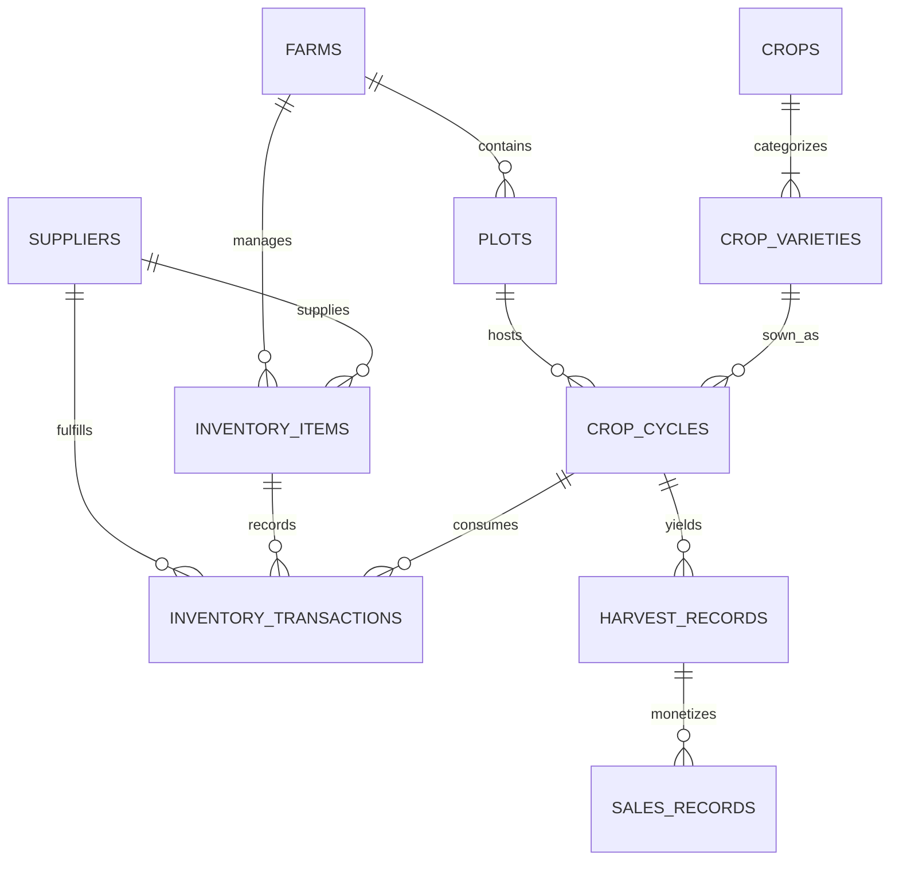

# FarmLedger — Farmer Crop Planning & Agricultural Inventory System
**University Database Management Systems (DBMS) Capstone Project**

---

## 1. Executive Summary & Problem Domain

Small and medium-scale farm managers routinely struggle with fragmented record-keeping. Sowing schedules, soil preparation, input expenditures (seeds, chemical fertilizers, organic pesticides), harvest batch records, and merchant sales are commonly scribbled on paper or recorded in disconnected spreadsheets. This results in:
1. **Inventory Stockouts & Wastage:** Critical inputs run out during tight planting windows, or expired agrochemicals accumulate unnoticed.
2. **Untracked Cost per Acre:** Farmers cannot isolate whether a specific crop variety or plot produced a profitable return after accounting for all input costs.
3. **Yield Variance Blindness:** Yield deficits caused by weather anomalies or soil degradation go unmeasured against agronomical benchmarks.

**FarmLedger** solves this with an **audit-grade, relational database architecture** at its core. Every input purchase, field application, harvest gathering, and produce sale is captured in normalized relational tables with database triggers enforcing data integrity.

---

## 2. System Architecture

The application is structured into three clean, decoupled tiers:

```
┌────────────────────────────────────────────────────────┐
│                   React 18 + Vite                      │
│     Tailwind CSS • Recharts • Lucide Iconography       │
└───────────────────────────┬────────────────────────────┘
                            │ HTTP / JSON REST
┌───────────────────────────▼────────────────────────────┐
│                  Node.js / Express                     │
│  REST Routing • Analytical Projections • Open-Meteo   │
└───────────────────────────┬────────────────────────────┘
                            │ Raw SQL (Zero ORM Abstraction)
┌───────────────────────────▼────────────────────────────┐
│             SQLite Relational Core Engine              │
│    3NF Schema • Triggers • Views • Indexes • DDL/DML   │
└────────────────────────────────────────────────────────┘
```

- **Frontend:** React with Vite and Tailwind CSS. Provides a minimal, white dashboard layout with tabbed operational workflows, interactive Recharts visualizations (category stock donut, 12-month dual-axis composed trend charts, multi-season yield bar charts), and CSV export capabilities.
- **Backend:** Node.js with Express. Exposes modular REST endpoints without an ORM layer, ensuring that raw SQL queries remain transparent, legible, and directly verifiable by DBMS examiners.
- **Database:** SQLite running in strict foreign-key mode (`PRAGMA foreign_keys = ON`), written in portable SQL standard syntax easily migratable to PostgreSQL or MySQL.
- **Dedicated SQL Files:**
  - `server/db/schema.sql`: Full DDL defining 3NF tables, constraints, triggers, indexes, and views.
  - `server/db/seed.sql`: 2-year chronological demo dataset (2024–2026) spanning farms, plots, crops, cultivars, inventory movements, harvests, and sales.
  - `server/db/queries.sql`: Documented analytical SQL queries demonstrating advanced DBMS concepts (CTEs, Window Functions, Group By Rollups, Relational Division).

---

## 3. Relational Schema & 3NF Normalization Reasoning

The relational data model is strictly normalized to **Third Normal Form (3NF)** to eliminate insert, update, and deletion anomalies.



### Normalization Breakdown:

1. **First Normal Form (1NF):**
   - All table attributes are atomic. There are no repeating groups or comma-separated lists (e.g., plot irrigation or soil types are discrete enum attributes; harvest batches are independent entity rows).
   - Each table possesses an explicit primary key (`id INTEGER PRIMARY KEY AUTOINCREMENT`).

2. **Second Normal Form (2NF):**
   - Eliminates partial dependencies on compound keys.
   - Crop genus characteristics (`crops`) are decoupled from variety-specific cultivar properties (`crop_varieties`). A cultivar like *HD-2967 Golden* depends on its own key, referencing parent crop *Wheat* via a foreign key (`crop_id`).
   - Plot geography and soil classifications depend on `plots(id)`, not partially on farm identifiers.

3. **Third Normal Form (3NF):**
   - Eliminates transitive functional dependencies ($X \to Y$ and $Y \to Z$).
   - Supplier contact information (`name`, `phone`, `email`, `rating`) is stored in an independent `suppliers` relation. `inventory_items` and `inventory_transactions` only reference `supplier_id`, preventing update anomalies when a vendor's contact number changes.
   - Harvested produce sales (`sales_records`) link directly to `harvest_id`. They do not store redundant crop or plot names; all operational context is resolved via relational joins.
   - Monetary totals (`total_cost`, `total_amount`) are declared as deterministic generated stored columns (`GENERATED ALWAYS AS (quantity * unit_price) STORED`), guaranteeing transactional consistency without denormalized anomalies.

---

## 4. Integrity Constraints & Database Triggers

### Constraints Implemented:
- **Foreign Key Actions:**
  - `plots` $\to$ `farms`: `ON DELETE CASCADE`
  - `crop_cycles` $\to$ `plots`: `ON DELETE RESTRICT` (prevents deleting active plots with crop history)
  - `inventory_transactions` $\to$ `inventory_items`: `ON DELETE RESTRICT`
  - `harvest_records` $\to$ `crop_cycles`: `ON DELETE CASCADE`
  - `sales_records` $\to$ `harvest_records`: `ON DELETE RESTRICT`
- **CHECK Constraints:**
  - `CHECK (area_acres > 0)` and `CHECK (total_area_acres > 0)`
  - `CHECK (quantity > 0)` and `CHECK (quantity_harvested > 0)` and `CHECK (quantity_sold > 0)`
  - `CHECK (expected_harvest_date >= sowing_date)`
  - `CHECK (rating >= 1.0 AND rating <= 5.0)`
  - Categorical enums: `soil_type IN ('Clay', 'Sandy Loam', 'Silt Loam', 'Clay Loam', 'Sandy', 'Black Soil', 'Red Soil', 'Alluvial')`
- **Compound UNIQUE Rules:**
  - `UNIQUE (farm_id, plot_code)`
  - `UNIQUE (crop_id, name)`
  - `UNIQUE (farm_id, name)` on inventory items

### Active Database Triggers:
1. **`trg_prevent_negative_inventory` (BEFORE INSERT on `inventory_transactions`):**
   - Checks if `transaction_type IN ('usage', 'wastage')`.
   - If requested `quantity > (SELECT current_stock FROM inventory_items WHERE id = NEW.inventory_item_id)`, it invokes `RAISE(ABORT, 'DBMS Constraint Violation: Insufficient stock. Requested quantity exceeds available inventory.')`.
2. **`trg_update_inventory_stock_after_insert` (AFTER INSERT on `inventory_transactions`):**
   - Automatically increments `current_stock` on `purchase` and decrements on `usage` or `wastage`.
   - Updates the item's latest `unit_cost` automatically when new purchases occur.
3. **`trg_prevent_overselling_harvest` (BEFORE INSERT on `sales_records`):**
   - Verifies that `SUM(quantity_sold) + NEW.quantity_sold <= harvest_records.quantity_harvested`.
   - Rejects the transaction with an abort exception if a merchant tries to buy more than what was harvested.
4. **`trg_update_crop_cycle_actual_yield` (AFTER INSERT/UPDATE/DELETE on `harvest_records`):**
   - Computes `SUM(quantity_harvested)` for the cycle and synchronizes `crop_cycles.actual_yield` and updates cycle status to `'Harvested'`.

---

## 5. SQL Views & Analytical Deliverables

The database defines five dedicated views:
- **`v_current_stock_levels`**: Combines item records, farm names, and suppliers to project current stock, unit cost, live valuation, and dynamic health status (`'In Stock'`, `'Low Stock'`, `'Out of Stock'`).
- **`v_low_stock_items`**: Filters items where `current_stock <= 10.0` or `current_stock <= reorder_level`.
- **`v_out_of_stock_items`**: Filters items with `current_stock <= 0.0`.
- **`v_monthly_inventory_value`**: Groups movements by `strftime('%Y-%m', transaction_date)` and aggregates purchases, usages, and net cash flow.
- **`v_estimated_vs_actual_yield`**: Joins crop cycles, varieties, and plots to calculate absolute yield variance and percentage deviation (`((actual - estimated) / estimated) * 100`).

---

## 6. Advanced DBMS Analytical Queries (`queries.sql`)

1. **Input Cost Per Acre per Crop Cycle:**
   Inner and outer joins across `crop_cycles`, `plots`, and `inventory_transactions` (`usage` type) to determine total expenditure normalized per acre.
2. **Yield Per Acre and Estimate vs. Actual Variance Analysis:**
   Computes actual harvest productivity per acre and flags cycles with critical yield deficits.
3. **Crop Economic Profitability & Return on Investment (ROI):**
   Utilizes Common Table Expressions (`WITH CycleCosts AS (...)`, `WITH CycleSales AS (...)`) to aggregate input expenses against gross merchant sales to compute net crop profit and ROI percentage.
4. **Seasonal Year-over-Year Performance Comparison:**
   Comparative seasonal metrics across consecutive agricultural years (e.g. Kharif 2024 vs Kharif 2025).
5. **Plot Cropping History & Rotation Sequence:**
   Demonstrates SQL Window Functions (`LAG(crop_name, 1) OVER (PARTITION BY plot_id ORDER BY sowing_date)`) and Julian date arithmetic to track previous crops and calculate fallow resting days between cycles.
6. **Underperforming Crop Cycles Alert (Deficit > 15%):**
   Filters harvested cycles where yield fell more than 15% below estimate for agronomical inquiry.

---

## 7. External Meteorological Integration (Open-Meteo)

The backend correlates the relational database with the **Open-Meteo Weather API** (free, no API key required):
- Queries a 7-day daily forecast based on the selected farm's coordinates (`latitude`, `longitude`).
- Synchronizes with active and planned `crop_cycles` for the farm.
- Evaluates operational hazard rules (+/- 3 days from sowing or harvest date):
  - **Heavy Rain Warning:** Flags precipitation $\ge 15\text{ mm/day}$ during sowing (risk of seedling waterlogging and poor emergence) or $\ge 10\text{ mm/day}$ at harvest (risk of mold and grain sprouting).
  - **Extreme Heat Warning:** Flags temperatures $\ge 35^\circ\text{C}$ during early crop establishment (risk of soil crusting and seedling desiccation).

---

## 8. Installation & Execution Guide

### Prerequisites:
- **Node.js** (v20+ recommended, works on v22 & v24)
- **npm** (v10+)

### Setup Steps:

1. **Clone or Open the Repository:**
   ```bash
   cd "c:\Users\Prakitesh\New folder (8)"
   ```

2. **Install Dependencies:**
   ```bash
   # Install server dependencies
   cd server
   npm install --no-optional
   cd ..

   # Install client dependencies
   cd client
   npm install
   cd ..
   ```

3. **Initialize & Seed the Database:**
   ```bash
   node server/db/seed.js
   ```
   *This creates a fresh `server/db/farmledger.db`, executes `schema.sql`, and inserts the 2-year realistic demo dataset from `seed.sql`.*

4. **Run the Application:**
   Open two terminal tabs:

   **Terminal 1 (Backend Server):**
   ```bash
   node server/index.js
   ```
   *Runs at `http://localhost:5000` (API routes at `/api`)*

   **Terminal 2 (Frontend Client):**
   ```bash
   npm --prefix client run dev
   ```
   *Runs Vite at `http://localhost:5173` with proxy to backend.*

5. **Open Browser:**
   Navigate to `http://localhost:5173` to explore the complete FarmLedger application.

---

## 9. DBMS Examination Concepts Demonstration Matrix

| DBMS Concept | Where Demonstrated in FarmLedger |
| :--- | :--- |
| **3NF Normalization** | `farms`, `plots`, `crops`, `crop_varieties`, `suppliers`, `inventory_items` in `schema.sql` |
| **Referential Integrity** | `ON DELETE CASCADE`, `ON DELETE RESTRICT`, `ON DELETE SET NULL` foreign keys |
| **Domain Integrity** | `CHECK` constraints on acreage, positive quantities, date sequences, rating limits |
| **Active Triggers** | `trg_prevent_negative_inventory`, `trg_update_inventory_stock_after_insert`, `trg_prevent_overselling_harvest`, `trg_update_crop_cycle_actual_yield` |
| **Database Views** | `v_current_stock_levels`, `v_low_stock_items`, `v_out_of_stock_items`, `v_monthly_inventory_value`, `v_estimated_vs_actual_yield` |
| **Index Optimization** | B-Tree indexes on all date columns (`transaction_date`, `sowing_date`, `harvest_date`, `sale_date`) and foreign keys |
| **Window Functions** | `LAG() OVER (PARTITION BY plot_id ORDER BY sowing_date)` in Query 5 for plot rotation history |
| **Common Table Expressions (CTEs)** | `WITH CycleCosts AS (...)`, `WITH CycleSales AS (...)` in Query 3 for crop ROI analysis |
| **Audit Ledger Pattern** | Append-only `inventory_transactions` table recording purchases, usages, adjustments, and wastages |
| **Analytical Reporting & CSV Export** | Dynamic SQL projections on cost/acre, yield/acre, and seasonal margins with RFC-4180 CSV generation |

