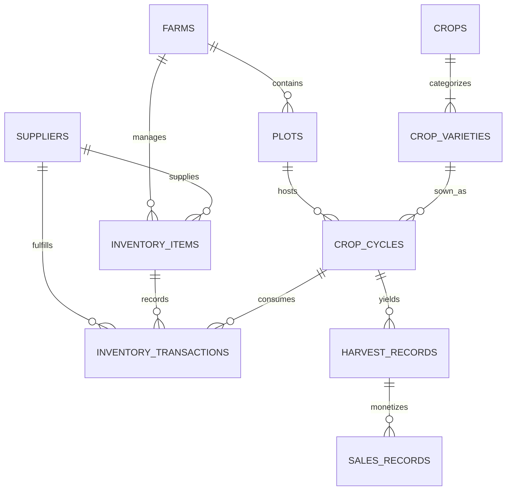

# FarmLedger — Farmer Crop Planning & Agricultural Inventory System
**University Database Management Systems (DBMS) Capstone Project**

---

## 1. Executive Summary & Problem Domain

Small and medium-scale farm managers routinely struggle with fragmented record-keeping. Sowing schedules, soil preparation, input expenditures (seeds, chemical fertilizers, organic pesticides), harvest batch records, and merchant sales are commonly scribbled on paper or recorded in disconnected spreadsheets. This results in:
1. **Inventory Stockouts & Wastage:** Critical inputs run out during tight planting windows, or expired agrochemicals accumulate unnoticed.
2. **Untracked Cost per Acre:** Farmers cannot isolate whether a specific crop variety or plot produced a profitable return after accounting for all input costs.
3. **Yield Variance Blindness:** Yield deficits caused by weather anomalies or soil degradation go unmeasured against agronomical benchmarks.

**FarmLedger** solves this with an **audit-grade, relational database architecture** at its core. Every input purchase, field application, harvest gathering, and produce sale is captured in normalized relational tables with database triggers enforcing data integrity.

---

## 2. System Architecture

The application is structured into three clean, decoupled tiers:

```
┌────────────────────────────────────────────────────────┐
│                   React 18 + Vite                      │
│     Tailwind CSS • Recharts • Lucide Iconography       │
│      Interactive DBMS Lab • Real-Time SQL Sandbox      │
└───────────────────────────┬────────────────────────────┘
                            │ HTTP / JSON REST
┌───────────────────────────▼────────────────────────────┐
│                  Node.js / Express                     │
│  REST Routing • Analytical Projections • Open-Meteo   │
│  Schema Introspection (PRAGMA) • Safe Query Executor   │
└───────────────────────────┬────────────────────────────┘
                            │ Raw SQL (Zero ORM Abstraction)
┌───────────────────────────▼────────────────────────────┐
│             SQLite Relational Core Engine              │
│  3NF Schema • 6 Triggers • 5 Views • B-Tree Indexes    │
└────────────────────────────────────────────────────────┘
```

- **Frontend:** React with Vite and Tailwind CSS. Features a clean, minimal design system with single emerald-green accent typography, tabbed operational workflows, interactive Recharts visualizations (category stock donut, 12-month dual-axis composed trend charts, multi-season yield bar charts), CSV export capabilities, and an interactive **DBMS Lab**.
- **Backend:** Node.js with Express. Exposes modular REST endpoints without an ORM layer, ensuring that raw SQL queries remain transparent, legible, and directly verifiable by DBMS examiners.
- **Database:** SQLite running in strict foreign-key mode (`PRAGMA foreign_keys = ON`), written in portable SQL standard syntax easily migratable to PostgreSQL or MySQL.
- **Dedicated SQL Files:**
  - `server/db/schema.sql`: Full DDL defining 10 normalized tables, primary/foreign keys, CHECK constraints, 6 triggers, B-tree indexes, and 5 views.
  - `server/db/seed.sql`: Complete 2-year chronological demo dataset (2024–2026) spanning all 12 months with realistic agricultural input-to-revenue ratios (ROI 200%–360%).
  - `server/db/queries.sql`: 8 documented analytical SQL queries demonstrating advanced DBMS concepts (CTEs, Window Functions, Group By Rollups, Date Arithmetic).

---

## 3. Relational Schema & 3NF Normalization Reasoning

The relational data model is strictly normalized to **Third Normal Form (3NF)** to eliminate insert, update, and deletion anomalies.



### The 10 Relational Tables:
1. `farms`: Primary holding entity (location, latitude, longitude, total acreage).
2. `plots`: Cultivated field parcels (area in acres, soil classification, irrigation type).
3. `crops`: Broad crop genus catalog (cereal, legume, vegetable, standard yield unit).
4. `crop_varieties`: Specific agronomic cultivars (days to maturity, expected yield per acre).
5. `crop_cycles`: Scheduled or completed crop seasons linking plots, cultivars, sowing/harvest dates, and yield estimates.
6. `suppliers`: Agricultural vendors for seeds, fertilizers, and equipment.
7. `inventory_items`: Registered stock SKUs with unit costs, reorder thresholds, and live balances.
8. `inventory_transactions`: Append-only audit ledger recording every purchase, usage, adjustment, and wastage.
9. `harvest_records`: Batches gathered from completed crop cycles with quality grades.
10. `sales_records`: Commercial produce sales tied directly to verified harvests.

### Normalization Breakdown:

1. **First Normal Form (1NF):**
   - All table attributes are atomic. There are no repeating groups or comma-separated lists (e.g. plot soil and irrigation classifications are discrete values; harvest batches are independent entity rows).
   - Each table possesses an explicit primary key (`id INTEGER PRIMARY KEY AUTOINCREMENT`).

2. **Second Normal Form (2NF):**
   - Eliminates partial dependencies on compound keys.
   - Crop genus characteristics (`crops`) are decoupled from variety-specific cultivar properties (`crop_varieties`). A cultivar like *HD-2967 Golden* depends on its own key, referencing parent crop *Wheat* via a foreign key (`crop_id`).
   - Plot geography and soil classifications depend on `plots(id)`, not partially on farm identifiers.

3. **Third Normal Form (3NF):**
   - Eliminates transitive functional dependencies ($X \to Y$ and $Y \to Z$).
   - Supplier contact information (`name`, `phone`, `email`, `rating`) is stored in an independent `suppliers` relation. `inventory_items` and `inventory_transactions` only reference `supplier_id`, preventing update anomalies when a vendor's contact number changes.
   - Harvested produce sales (`sales_records`) link directly to `harvest_id`. They do not store redundant crop or plot names; all operational context is resolved via relational joins.
   - Monetary totals (`total_cost`, `total_amount`) are declared as deterministic generated stored columns (`GENERATED ALWAYS AS (quantity * unit_price) STORED`), guaranteeing transactional consistency without denormalized anomalies.

---

## 4. Integrity Constraints & The 6 Database Triggers

### Constraints Implemented:
- **Foreign Key Referential Actions:**
  - `plots` $\to$ `farms`: `ON DELETE CASCADE`
  - `crop_cycles` $\to$ `plots`: `ON DELETE RESTRICT` (prevents deleting active plots with crop history)
  - `inventory_transactions` $\to$ `inventory_items`: `ON DELETE RESTRICT`
  - `harvest_records` $\to$ `crop_cycles`: `ON DELETE CASCADE`
  - `sales_records` $\to$ `harvest_records`: `ON DELETE RESTRICT` (prevents deleting harvests with sales)
- **CHECK Constraints:**
  - `CHECK (area_acres > 0)` and `CHECK (total_area_acres > 0)`
  - `CHECK (quantity > 0)` and `CHECK (quantity_harvested > 0)` and `CHECK (quantity_sold > 0)`
  - `CHECK (expected_harvest_date >= sowing_date)`
  - `CHECK (rating >= 1.0 AND rating <= 5.0)`
  - Categorical domain enums: `soil_type IN ('Clay', 'Sandy Loam', 'Silt Loam', 'Clay Loam', 'Sandy', 'Black Soil', 'Red Soil', 'Alluvial')`
- **Candidate Key Constraints:**
  - `UNIQUE (plot_code)` on plots
  - `UNIQUE (crop_id, name)` on crop varieties
  - `UNIQUE (farm_id, name)` on inventory items

### The 6 Active Database Triggers:
1. **`trg_prevent_inventory_underflow_insert` (BEFORE INSERT on `inventory_transactions`):**
   - Evaluates if `transaction_type IN ('usage', 'wastage')`.
   - Checks: `(SELECT current_stock FROM inventory_items WHERE id = NEW.inventory_item_id) < NEW.quantity`.
   - Aborts with `RAISE(ABORT, 'DBMS Constraint Violation: Insufficient stock. Requested quantity exceeds available inventory.')`.
2. **`trg_update_inventory_stock_insert` (AFTER INSERT on `inventory_transactions`):**
   - Automatically increments `current_stock` on `purchase` and decrements on `usage` or `wastage`.
   - Automatically syncs item `unit_cost` to the latest purchase cost.
3. **`trg_prevent_harvest_overselling` (BEFORE INSERT on `sales_records`):**
   - Verifies that `COALESCE(SUM(quantity_sold), 0) + NEW.quantity_sold <= harvest_records.quantity_harvested`.
   - Rejects the transaction with an abort exception if a merchant tries to buy more than what was harvested.
4. **`trg_update_crop_cycle_actual_yield_insert` (AFTER INSERT on `harvest_records`):**
   - Automatically aggregates `SUM(quantity_harvested)` into `crop_cycles.actual_yield` and flips cycle status from `Growing` to `Harvested`.
5. **`trg_update_crop_cycle_actual_yield_update` (AFTER UPDATE on `harvest_records`):**
   - Re-syncs `actual_yield` on old and new crop cycles if quantity or cycle association is modified.
6. **`trg_update_crop_cycle_actual_yield_delete` (AFTER DELETE on `harvest_records`):**
   - Recalculates `actual_yield` if a harvest record is removed.

---

## 5. SQL Views & Analytical Deliverables

The database defines 5 dedicated views:
- **`v_current_stock_levels`**: Combines item records, farm names, and suppliers to project current stock, unit cost, live valuation, and dynamic health status (`'In Stock'`, `'Low Stock'`, `'Out of Stock'`).
- **`v_low_stock_items`**: Filters items where `current_stock > 0 AND current_stock <= reorder_level`.
- **`v_out_of_stock_items`**: Filters items where `current_stock <= 0.0`.
- **`v_monthly_inventory_value`**: Groups movements by `strftime('%Y-%m', transaction_date)` and aggregates purchases, usages, and net cash flow.
- **`v_estimated_vs_actual_yield`**: Joins crop cycles, varieties, and plots to calculate absolute yield variance and percentage deviation (`((actual - estimated) / estimated) * 100`).

---

## 6. The 8 Analytical DBMS Queries (`queries.sql`)

1. **Query 1: Input Cost Per Acre per Crop Cycle**
   - *Question Answered:* What is the total expenditure on seeds, fertilisers, and pesticides for each completed or active crop cycle, normalized per cultivated acre?
   - *DBMS Concepts:* `INNER JOIN`, `LEFT JOIN`, `SUM` with `NULL` coalescence, computed metric.
2. **Query 2: Yield Per Acre and Estimate vs. Actual Variance Analysis**
   - *Question Answered:* How productive was each crop cycle per acre, and what percentage did the actual harvested yield deviate from the agronomist estimate?
   - *DBMS Concepts:* Mathematical projection, conditional `CASE` logic, threshold flagging.
3. **Query 3: Crop Economic Profitability & Return on Investment (ROI)**
   - *Question Answered:* Which crop generated the highest gross revenue, net profit, and profit margin after deducting all direct input usage expenses?
   - *DBMS Concepts:* Common Table Expressions (`WITH CycleCosts AS (...)`, `WITH CycleSales AS (...)`), outer aggregations, financial modeling.
4. **Query 4: Seasonal Year-over-Year Performance Comparison**
   - *Question Answered:* How do yields and input expenditures compare across major agrarian seasons (e.g. Kharif 2024 vs Kharif 2025)?
   - *DBMS Concepts:* Seasonal grouping, comparative metrics, multi-year trend.
5. **Query 5: Plot Cropping History & Rotation Sequence**
   - *Question Answered:* What is the historical chronological succession of crops grown on each plot, helping detect monoculture risk or nitrogen depletion?
   - *DBMS Concepts:* Window Functions (`LAG() OVER (PARTITION BY plot_id ORDER BY sowing_date)`), Julian date arithmetic.
6. **Query 6: Underperforming Crop Cycles Alert (Deficit > 15%)**
   - *Question Answered:* Which crop cycles produced harvest yields more than 15% below estimate, requiring agronomical investigation or insurance review?
   - *DBMS Concepts:* Filtering on computed expressions (`WHERE ((actual - estimated) / estimated) < -0.15`).
7. **Query 7: Monthly Inventory Movement and Valuation Trends**
   - *Question Answered:* How does inventory expenditure fluctuate month-by-month between bulk purchases, field applications (usage), and wastage?
   - *DBMS Concepts:* Date formatting (`strftime`), pivot aggregations, rolling cash flow.
8. **Query 8: Inventory Stock Health Classification**
   - *Question Answered:* Which inventory items require immediate supplier reordering or are critical stockouts?
   - *DBMS Concepts:* Domain classification `CASE` expressions, supplier outer joins.

---

## 7. NEW: Interactive "DBMS Lab" Section

FarmLedger includes a dedicated sidebar page titled **"DBMS Lab"** created specifically for studying and demonstrating database concepts during a project evaluation:
1. **Interactive ER Diagram (10 Tables):** Click any table to inspect live row counts, columns, data types, nullability, PK/FK indicators, and raw DDL statements generated by the database engine.
2. **Normalisation Walkthrough (1NF $\to$ 2NF $\to$ 3NF):** Plain-English side-by-side comparison of "Bad Unnormalised Design" vs. "FarmLedger 3NF Solution" showing how insertion, update, and deletion anomalies are avoided.
3. **Triggers Live Sandbox:** One-click real-time trigger tester executing against the live SQLite database inside an isolated transaction that is cleanly rolled back:
   - *Test 1:* Attempt to log usage of 9,999 bags of Urea $\to$ blocked by `trg_prevent_inventory_underflow_insert`.
   - *Test 2:* Attempt to sell 50 quintals from Harvest #10 (only 5 q remaining) $\to$ blocked by `trg_prevent_harvest_overselling`.
   - *Test 3:* Attempt to add a plot with duplicate code `'P-NORTH-01'` $\to$ blocked by candidate key `UNIQUE(plot_code)`.
   - *Test 4:* Test automated harvest roll-up $\to$ adds harvest to Cycle #11 (status: 'Growing') and watches `trg_update_crop_cycle_actual_yield_insert` automatically roll up yield and flip status to 'Harvested'.
4. **SQL Playground:** Dropdown of all 8 analytical queries with explanation, raw SQL editor, a Run button, query execution time (ms), and dynamic result table. Also supports arbitrary read-only custom `SELECT` / `WITH` queries (mutation commands like `INSERT`/`UPDATE`/`DELETE`/`DROP` are strictly blocked).
5. **Concepts Cheat-Sheet:** Matrix mapping each DBMS concept (keys, constraints, triggers, views, CTEs, window functions, generated columns) to the exact source file and line numbers.
6. **DBMS Viva Quiz (15 Questions):** 15 multiple-choice questions specifically based on FarmLedger's architecture with instant feedback, scoring, and explanations.

---

## 8. Installation & Setup Guide (Windows / Mac / Linux)

### Prerequisites:
- **Node.js** (v20+ recommended, works on v22 & v24)
- **npm** (v10+)

### Setup Instructions:

```bash
# 1. Install root, server, and client dependencies
npm run install:all

# 2. Build the production React client
npm run build

# 3. Seed the database with 2-year realistic demo data
npm run seed

# 4. Start the application
npm start
```

*The application runs at **`http://localhost:5000`** (serving both the backend API and production React frontend).*

For development mode with Vite hot-reload:
```bash
# Terminal 1: Backend
npm run server

# Terminal 2: Frontend
npm run client
```

---

## 9. 5-Minute Teacher Demonstration Script

Follow these exact steps in front of your examiner:

1. **Minute 1: Dashboard Overview (Dashboard & Tabs)**
   - Open `http://localhost:5000`.
   - Point out the clean **Farm Dashboard** and switch between the **Financial**, **Operations**, and **Inventory** tabs.
   - Show the 6 Inventory stat cards: point out **Low Stock** (MOP Potash $\le$ 10 reorder level) and **Out of Stock** (Neem Oil = 0 units).
   - Point out the 12-month trend chart showing continuous purchase and usage lines across all 12 months.

2. **Minute 2: Append-Only Ledger & Database Triggers**
   - Click **Inventory** $\to$ **Transactions Ledger** in the sidebar.
   - Explain: *"Our inventory uses an append-only ledger pattern. We never overwrite stock numbers directly; every movement is recorded as an immutable row, and database triggers maintain live balances."*
   - Click **Log Field Usage**, select Urea, and enter `9999` bags.
   - Click submit: Show the examiner the exact database trigger error:  
     `DBMS Constraint Violation: Insufficient stock. Requested quantity exceeds available inventory.`

3. **Minute 3: Open the DBMS Lab (ER Diagram & Table Inspector)**
   - In the sidebar, click the green **DBMS Lab** button.
   - Tab 1 (**ER Diagram**): Click `crop_cycles`, `inventory_transactions`, and `sales_records`.
   - Show the examiner:
     - The Surrogate Primary Keys (`id`).
     - Foreign Keys enforcing `ON DELETE RESTRICT` (preventing accidental deletion of plots or harvests with active financial records).
     - Generated column `sales_records.total_amount` (`STORED`).

4. **Minute 4: Normalisation (1NF $\to$ 2NF $\to$ 3NF)**
   - Switch to the **Normalisation** tab in the DBMS Lab.
   - Walk through:
     - **1NF:** How comma-separated input lists were eliminated so each fertilizer entry has an atomic quantity and cost.
     - **2NF:** How cultivar properties (`days_to_maturity`) were separated from `crops` to eliminate partial key dependencies.
     - **3NF:** How vendor details were isolated in `suppliers` so `inventory_items` avoids transitive dependencies.

5. **Minute 5: Live Trigger Sandbox & SQL Playground**
   - Switch to the **Triggers Live Sandbox** tab.
   - Click **Execute Oversell Test (Sell 50 q)**: Show how Harvest #10 only has 5 quintals unsold and trigger `trg_prevent_harvest_overselling` rejects overdrawing. Explain that this was safely tested inside a rolled-back transaction so live data is unharmed.
   - Switch to the **SQL Playground** tab.
   - Select **Query 3: Crop Economic Profitability & ROI**.
   - Click **Run Query**: Show the examiner the live results table demonstrating Common Table Expressions (CTEs) computing realistic **200%–360% ROI** across crops!
   - Optional flex: Switch to the **DBMS Viva Quiz** tab and show the 15 project-specific questions!
